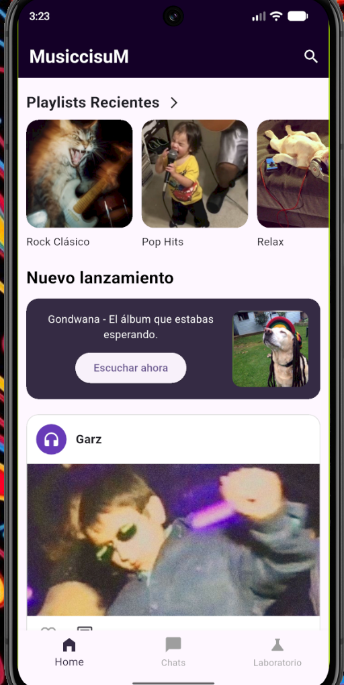
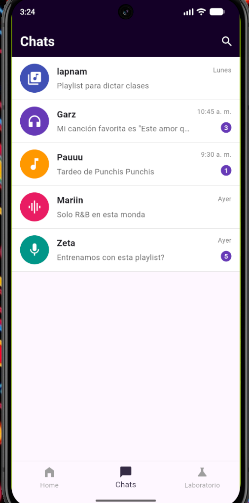
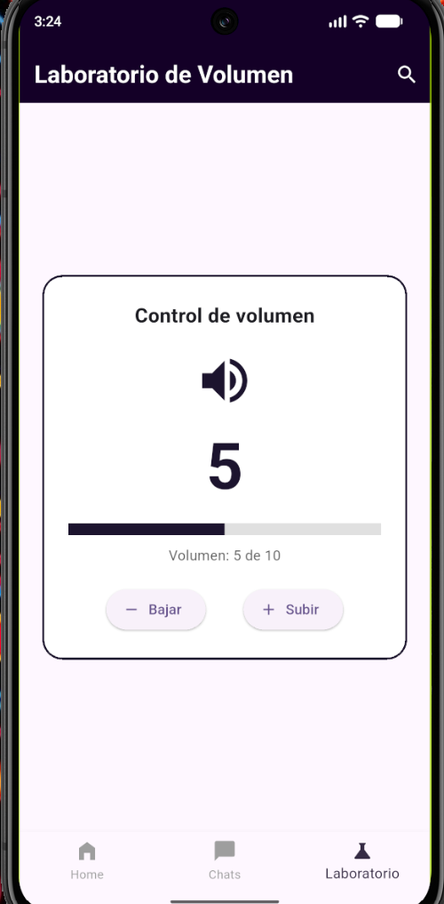

# Musiccisum

Aplicación móvil desarrollada con **Flutter y Dart** para el Taller de desarrollo móvil. Tiene temática de música e imita una red social musical.

## Descripción

La aplicación tiene tres secciones, a las que se navega con una barra de navegación inferior (`BottomNavigationBar`):

- **Home:** un banner promocional, un carrusel horizontal de playlists recomendadas y dos publicaciones creadas con el widget `PostCard`, cada una con botón de "Me gusta" y comentarios.
- **Chats:** una lista de cinco conversaciones creadas con el widget `ChatTile`, con avatar, nombre, último mensaje, hora e indicador de mensajes sin leer.
- **Laboratorio de widgets:** un control de volumen con botones para subir y bajar, que usa una variable `int`, límites de 0 a 10 y `setState()`.

Todos los datos son estáticos y están escritos directamente en el código. No se usan bases de datos, JSON, APIs ni servicios externos.

## Capturas de pantalla

### Home



### Chats



### Laboratorio de widgets



## Estructura del proyecto

```
lib/
├── main.dart
├── screens/
│   ├── home_screen.dart
│   ├── chats_screen.dart
│   └── laboratory_screen.dart
└── widgets/
    ├── post_card.dart
    ├── promotional_banner.dart
    ├── image_carousel.dart
    ├── chat_tile.dart
    └── numeric_counter.dart
```

## Cómo ejecutar el proyecto

1. Instalar [Flutter](https://docs.flutter.dev/get-started/install) y verificar la instalación con:
```
   flutter doctor
```
2. Clonar el repositorio y entrar a la carpeta del proyecto:
```
   git clone https://github.com/Lapnam/Taller_Moviles.git
   cd Taller_Moviles
```
3. Descargar las dependencias:
```
   flutter pub get
```
4. Abrir un emulador Android o conectar un celular y ejecutar:
```
   flutter run
```

## Tecnologías

- Flutter
- Dart